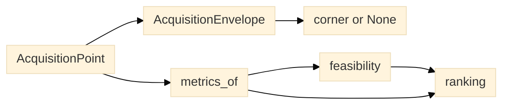

# Acquisition-space model

`planner.acquisition_space` implements the first concrete model of the
acquisition control vector `u = (v, T_e, W)`: stage velocity, exposure time and
the active detection width along the scan axis. It is pure data and arithmetic.
It emits no device command and no Bluesky plan message, creates no RunEngine and
asserts nothing about hardware capability; plan lowering stays in
`planner.plans`.



*Figure 1. Classification, metrics, feasibility and ranking are separate steps;
each output is inert data.*

## Axes and units

| Symbol | Meaning | Unit | Field |
|---|---|---|---|
| `v` | stage velocity along the scan axis | `um/s` | `velocity_um_s` |
| `T_e` | camera exposure time | `s` | `exposure_s` |
| `W` | active detection width along the scan axis | `um` | `width_um` |
| `T_f` | camera frame period | `s` | `frame_period_s` |
| `s` | object-space pixel pitch | `um/px` | `pixel_size_um` |
| `delta0` | stationary optical resolution scale | `um` | `resolution_um` |
| `H` | swath height perpendicular to scanning | `um` | `height_um` |

`pixel_size_um` is the object-space pitch `s = p / M`, not the physical detector
pitch, so `W` and `H` are already specimen-plane micrometres. Exposure and frame
period are separate: `T_e <= T_f`, and the duty cycle is their ratio.

## Envelope, bands and corners

Low and high are relative to a caller-declared useful range, never universal
thresholds. `AcquisitionEnvelope` holds one `AxisThreshold(low_max, high_min)`
per axis. `band(axis, value)` returns `AxisBand.LOW` when `value <= low_max`,
`AxisBand.HIGH` when `value >= high_min`, and `AxisBand.BETWEEN` otherwise.
`corner(point)` returns `None` when any axis is between; otherwise it returns
the corresponding `OperatingCorner`, coded in `(v, T_e, W)` order.

| Corner | Regime | Example | Qualification |
|---|---|---|---|
| `000` | Localized high-speed sampling | Fast time series of a narrow region | Not intrinsically line-confocal |
| `001` | High-speed widefield timelapse | Single-FOV live-cell dynamics | Standard widefield regime |
| `010` | Localized photon integration | Long-exposure, narrow-ROI fluorescence measurement | Not TDI if stage is stationary |
| `011` | Widefield photon integration | Low-signal stationary widefield imaging | Intensity/SNR prioritized over sampling rate |
| `100` | Motion-frozen push-broom scanning | Continuous strip-based imaging | Short exposure relative to displacement |
| `101` | Motion-frozen panoramic sampling | Rapid snapshot search or widefield panorama | Search coverage may differ from gap-free mapping |
| `110` | Motion-integrated strip imaging | Registered multi-frame accumulation; deconvolution | Digital TDI is a processing strategy, not the corner itself |
| `111` | Motion-integrated panoramic imaging | Coarse searching; computational deblurring | Long-exposure blur can reduce target detectability |

`OperatingCorner.digit(axis)`, `is_low`, `is_high`, `hamming_distance`,
`is_adjacent` and `changed_axes` make the cube explicit. `CORNERS` carries the
eight taxonomy rows, and `EXAMPLE_TRAJECTORIES` carries the four documented
transitions:

| Transition | Intent |
|---|---|
| `101 -> 001` | Fast area search, then stationary high-speed timelapse after target detection |
| `101 -> 011` | Search, then stationary sensitive imaging of a weak target |
| `100 -> 110` | Motion-frozen line scan, then registered temporal accumulation for SNR |
| `101 -> 111` | Short-exposure widefield scan, then motion-integrated panorama |

Three of those change one axis. `101 -> 011` changes both `v` and `T_e`, so a
documented trajectory does not imply Hamming adjacency; use
`OperatingCorner.is_adjacent` when a one-axis move is required.

## Metrics

For a point with `v > 0`:

```text
L_b       = v * T_e                       motion blur during one exposure
L_f       = v * T_f                       movement between frames
T_obs     = W / v                         residence in the active width
N_obs     = W / (v * T_f)                 successive observations per location
Phi_A     = v * H                         ideal unique-area throughput
eta       = W / (v * T_f) = 1 / gamma     overlap; equals N_obs
beta      = v * T_e / delta0              blur relative to resolution
gamma     = v * T_f / W                   interframe shift relative to width
d         = T_e / T_f                     exposure duty cycle
sigma_eff = sqrt(delta0^2 + (v*T_e)^2/12) effective blur under a box kernel
blur_ratio = sigma_eff / delta0
```

The stationary PSF scale is `sigma0 = delta0`. The residence/throughput identity
is `T_obs * Phi_A = W * H`. For `v = 0`, `T_obs`, `N_obs`, `eta` and `gamma` are
`None`, never `0` or infinity: observation duration is then set by the
experiment schedule, timing, bleaching and drift. `Phi_A`, `beta`, `d`, the
effective sigma and the blur ratio remain meaningful at `v = 0`.

An illustrative 100x detector calculation uses `s = 0.065 um/px`,
`v = 100 um/s` and `T_f = 0.01 s`:

| Scan-axis ROI | `W` | `T_obs` | `N_obs` |
|---:|---:|---:|---:|
| 32 px | 2.08 um | 20.8 ms | 2.08 |
| 128 px | 8.32 um | 83.2 ms | 8.32 |
| 512 px | 33.28 um | 332.8 ms | 33.28 |
| 2048 px | 133.12 um | 1331.2 ms | 133.12 |

## Feasibility

Feasibility is separate from utility. `MeasurementLimits` declares a
`max_blur_ratio`, a `max_gamma`, and optionally `min_observations`, `min_duty`
and `max_duty`. `assess_measurement(point, limits)` returns a
`MeasurementVerdict` and accumulates every violated reason:

| Reason | Trigger |
|---|---|
| `blur` | `blur_ratio > max_blur_ratio` |
| `gap` | moving point with `gamma > max_gamma` |
| `too_few_observations` | moving point with `N_obs < min_observations` |
| `duty` | `d < min_duty` or `d > max_duty` |

A value exactly at a ceiling or bound is feasible. The `gap` and
`too_few_observations` checks are skipped when `v = 0` because `gamma` and
`N_obs` are undefined there. Reasons are reported in that fixed order.

## Utility and ranking

`Utility` is a structural protocol with `score(point, metrics) -> float`.
`SearchUtility` is the first concrete objective: it scores feasible candidates
by ideal unique-area throughput `Phi_A`, the searched area per second. It
deliberately does not invent a detection probability, sensitivity or
false-negative model; the quality constraints belong to the feasibility verdict.
The throughput is idealized and ignores acceleration, turnaround, overlap,
unusable edge pixels, autofocus and camera timing, so it is a ceiling rather than
a prediction of realized search performance.

`rank_by_utility(points, utility, limits=None)` scores every input and returns
`ScoredPoint` records. Feasible points come first, sorted by descending score
with input order breaking ties. Rejected points follow in input order and keep
their verdict, reasons and score, so they remain distinguishable instead of being
silently dropped; a rejected point's score is informational only.

```python
from planner import (
    AcquisitionEnvelope,
    AcquisitionPoint,
    AxisThreshold,
    MeasurementLimits,
    SearchUtility,
    assess_measurement,
    rank_by_utility,
)

envelope = AcquisitionEnvelope(
    velocity_um_s=AxisThreshold(1.0, 50.0),
    exposure_s=AxisThreshold(0.005, 0.05),
    width_um=AxisThreshold(8.0, 64.0),
)
point = AcquisitionPoint(
    velocity_um_s=100.0,
    exposure_s=0.002,
    width_um=80.0,
    frame_period_s=0.01,
    pixel_size_um=0.065,
    resolution_um=0.2,
    height_um=133.12,
)
print(envelope.corner(point))  # 101: v and W are high, T_e is low
limits = MeasurementLimits(max_blur_ratio=1.5, max_gamma=0.5)
print(assess_measurement(point, limits).reasons)
ranked = rank_by_utility([point], SearchUtility(), limits)
```

The model is a planning and analysis contract only. A host still owns device
capability checks, stage limits, timing, calibration and execution policy.
