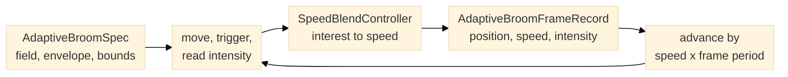

# Adaptive broom plan

`planner.adaptive_broom` walks a bounded rectangular field row by row and lets
one measured intensity signal set the next frame's speed. It complements the
declared-sample timing model in [the broom model](broom.md): that model asks
what a declared speed policy would cost, while this plan asks a host to supply
the intensity and execute the resulting steps.

*Figure 1. One causal loop: each frame's intensity becomes a bounded speed
request, and that request also sets the along-row step.*

## Host bindings

The plan is hardware-free. A host supplies:

| Binding | Contract |
| --- | --- |
| `stage_xy` or `stage_x`/`stage_y` | Bluesky movable stage axes, the same shape `planner.snap_scan_plan` accepts. |
| `camera` | Triggerable, readable frame device; the plan triggers it before each frame and reads it into the event. |
| `intensity_of_frame(index)` | Bluesky plan that returns one finite nonnegative intensity measure. |
| `command_speed(speed_um_s)` | Optional Bluesky plan that applies or records the bounded speed request. |
| `on_frame(record)` | Optional host callback that receives each `AdaptiveBroomFrameRecord` as it is produced, so partial evidence survives a failure. |

The plan emits one event per frame with the camera reading, any `readables`, and
the record fields `adaptive_frame_index`, `adaptive_row`, `adaptive_column`,
`adaptive_intensity`, `adaptive_interest`, `adaptive_blend_fraction`,
`adaptive_desired_speed_um_s`, `adaptive_speed_um_s` and `adaptive_step_um`.
It returns an `AdaptiveBroomResult` with the spec, records, row count and a
truncation flag.

## Speed rule

`interest = min(1, intensity / intensity_scale)`. The existing
`SpeedBlendController` carries a causal smoothed interest, maps it through the
fast/slow thresholds to a blend, and applies the configured acceleration slew
bound. The plan clamps the request to `[slow, fast]` and to the declared stage
ceiling.

The plan advances by `commanded_speed_um_s * frame_period_s`. A flat field
therefore starts and stays at the fast speed and covers a row in coarse steps;
an intensity rise slows the request and tightens the along-row sampling. Row
direction alternates (serpentine). Because the last frame of a row lands within
one step of the edge, the plan claims row coverage within one step, not exact
edge coverage.

`max_frames` bounds the run. Reaching it sets `truncated=True` in the result and
allows a slow region to end the raster early.

## Limits

- The intensity measure is host-defined. The plan normalizes it; it does not
  filter, background-correct or validate an image statistic.
- The commanded speed is a request. Whether it becomes a real velocity, a
  dwell, or only a spatial step is the host adapter's contract, and the plan
  makes no claim about measured stage acceleration or arrival.
- The declared stage envelope is checked against the field rectangle only. Live
  limits, resource ownership, camera mode and calibration acceptance remain the
  host's preflight.
- No acquisition, napari or RTASPT import is involved; the package boundary test
  covers this module.
