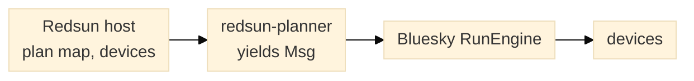
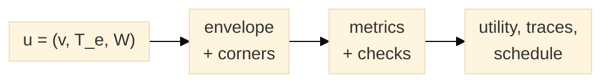
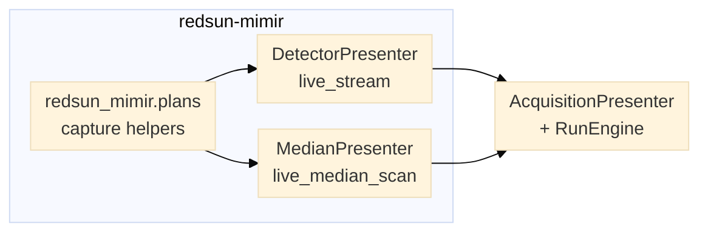
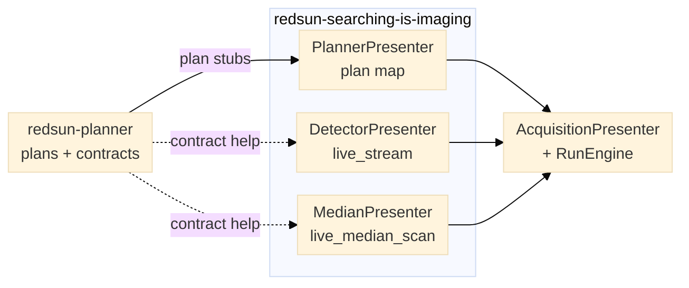
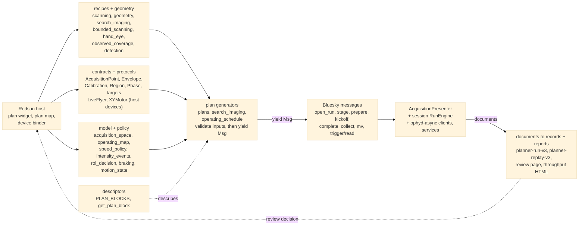

# Architecture and host composition

`redsun-planner` computes acquisition plans and the data behind them. A host owns
the devices, the RunEngine, preflight, storage and operator review. These diagrams
show the module boundary, the SPARTA model, and how two hosts compose the planner's
plan map. They describe software structure only: a plan or a descriptor does not
assert device capability, calibrated limits or acquisition quality. The figures use
compact left-to-right layouts at 15px so each one fits a documentation column.

## Module and interfaces

*Figure 1. The planner ingests inert inputs and bound devices, and emits Bluesky
messages. It never creates the engine that runs them.*

The host chooses a plan, resolves its typed arguments against session devices, and
passes the generator to its own RunEngine. The planner validates the inputs, yields
`Msg` objects and records planner-owned run metadata such as recipe or boundary
identity, coordinate frame, calibration identifier and expected event counts.

- **Ingests.** Typed recipes and geometry (`StageScanRecipe`, `SnapScanPlan`,
  `BroomScanPlan`, `ObservedSnapGridFit`), calibration and region records,
  envelope and capability snapshots, host-selected targets, and device objects
  that satisfy the `LiveFlyer` and `XYMotor` structural protocols. Explicit host
  callbacks cover camera preparation, per-frame capture, progress, per-strip
  validation and post-scan actions.
- **Emits.** `Msg` sequences through `MsgGenerator` functions, planner-owned run
  metadata, plan-block descriptors, JSON-safe records and self-contained HTML
  reports.
- **Never.** The planner creates no RunEngine, submits no message, opens no device
  and writes no camera store. Detection, image registration, stitching and
  persistence remain host operations. It fits a hand-eye transform only from
  registered correspondences that the host supplies.

A plan-block descriptor lists arguments, units, device contracts, resources,
physical effects and preconditions. It is discovery and help text, not preflight:
the host still checks capabilities, travel limits, resource locks, confirmation and
the terminal state.

## SPARTA model

**SPARTA** — Spatiotemporal Pareto Acquisition-Regime Trajectory Allocation — names
the optimization framework over the acquisition space. The state is
`u = (v, T_e, W)`: stage velocity, exposure time and active detection width along
the scan direction. The public types keep plain names: `AcquisitionPoint`,
`AcquisitionEnvelope`, `OperatingTrace` and `SearchUtility`.

*Figure 2. The analytic model is implemented. The fitted performance artifact and
its refit loop are planned; the planner reads such an artifact as data and carries no
optimizer.*

Low and high digits are relative to a caller-declared useful range, never universal
thresholds. A point with one axis between bands stays unlabelled instead of being
snapped to a corner. Feasibility is separate from utility: the feasibility verdict
reports blur, gap, observation-count and duty violations, and ranking places feasible
points first. Operating traces and their three projections are report data, not
evidence that a stage can execute the path.

See the [SPARTA framework](sparta.md) for the naming rules and the
[acquisition-space model](acquisition_space.md) for the equations, corner table and
feasibility contract.

## Plan presenters in two hosts

Both hosts run plans on a framework `AcquisitionPresenter`, which gathers each
component's `plan_map` and resolves the typed arguments. They differ in what
contributes plans and where the acquisition logic lives. `redsun-mimir` keeps two
small plan sources in the bundle; the Redsun searching and imaging application
projects an installed planner distribution into its presenter and binds session
devices at the composition edge.

An older `redsun-mimir` checkout may still ship a bundle-local
`AcquisitionPresenter`. That changes where the engine lives, not the plan sources
below; current main uses the framework presenter.

### redsun-mimir

*Figure 3. `redsun-mimir` contributes two plan-map entries. Their capture and
prepare/teardown helpers are local functions, so there is no external plan package,
no planner block descriptor and no device binder.*

### redsun-searching-is-imaging

*Figure 4. The searching application takes its plan stubs and contract text from the
installed planner, binds session devices in `acquisition/`, and lets `PlannerPresenter`
expose the resulting plan map.*

`PlannerPresenter` registers the planner-bound entries plus device-free geometry
previews, schedule review and offline registration, review and stitching actions:
34 entries at the time of writing. Eleven carry a planner block contract, and the
detector and median presenters add one each. The binders do not implement plan logic;
they translate session devices into the structural contracts the planner expects and
keep host policy at the application edge.

## Full architecture graph

The in-page figures isolate one view each. The
[full architecture graph](architecture-full.svg) puts the module groups, execution
path and review loop in one SVG; open it at full size rather than scaling it into
the column.

Mermaid source for the full graph

## Related pages

- [SPARTA framework](sparta.md)
- [Acquisition-space model](acquisition_space.md)
- [Plan-block descriptors](plan_blocks.md)
- [Two-round search-and-image workflow](search_imaging.md)
