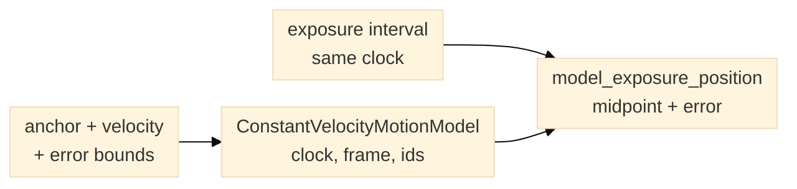

# Commanded motion context

`ConstantVelocityMotionModel` represents a declared XY constant-velocity
segment between two times in one explicitly named clock domain. It requires a
start-position anchor, velocity vector, coordinate-frame name, motion-request
ID, anchor ID, calibration ID, and per-axis position/velocity error bounds.
The anchor bound must include uncertainty in when the anchor applies, the
readback used to establish it, and the scale calibration.
`model_exposure_position`
accepts an exposure interval only when its midpoint lies inside the segment and
it uses the same clock ID; it returns the position at the exposure midpoint
and a conservative axis-wise error bound. The bound sums anchor, velocity and
clock-mapping contributions, including their first-order cross term, without
assuming that the sources are statistically independent.



*Figure 1. The model predicts a pose only for an exposure whose midpoint lies
inside the declared segment and clock domain.*

The result is always labelled `commanded_constant_velocity_model`. It is a
trajectory prediction, not a stage readback or exposure-synchronized
measurement. Callers must provide the clock association, anchor, calibration
and uncertainty; the planner does not query a device, infer timing from image
arrival, or supply a default physical scale. Use the model only for segments
whose motion is appropriately represented by constant velocity. For ramps,
reversals, stalls or unknown motion, preserve telemetry or leave pose unknown.

```python
from planner import ConstantVelocityMotionModel, model_exposure_position

motion = ConstantVelocityMotionModel(
    motion_request_id="strip-01-traverse-02",
    anchor_id="stage-readback-0001",
    calibration_id="xy-scale-review-v1",
    clock_id="host-monotonic-ns-via-reviewed-map",
    coordinate_frame="stage-xy-um",
    start_time_s=12.0,
    end_time_s=14.0,
    anchor_xy_um=(100.0, 250.0),
    velocity_xy_um_s=(40.0, -5.0),
    anchor_error_bound_xy_um=(0.5, 0.5),
    velocity_error_bound_xy_um_s=(1.0, 1.0),
)
pose = model_exposure_position(
    motion,
    exposure_start_s=12.4,
    exposure_end_s=12.42,
    clock_id=motion.clock_id,
    clock_mapping_uncertainty_s=0.001,
)
```

This API produces model values only. An acquisition host must retain the model
ID, request ID, anchor ID, calibration ID, coordinate frame and error bound with
each associated frame. It must keep measured readback pose in a distinct
field/provenance category.
