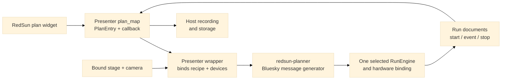

# RedSun presenter plan-widget adapter example

**Status:** integration sketch for the primary RedSun workflow. It has not been
installed into a RedSun plugin or exercised through the plan widget. The
example imports Bluesky,
`event_model` and the planner but not `redsun`; runtime verification belongs in
the RedSun plugin/session environment.

This example wraps one existing `redsun-planner` snap plan in the presenter
`plan_map` contract. The planner stays a reusable Bluesky library: RedSun types
and decorators belong in the host-side adapter, not in `planner` modules. The
presenter receives a validated recipe and already-bound devices from its host;
the runtime remains responsible for preflight limits, command authority,
camera settings, cancellation, and run storage.

## Adopted application and audited composition shape

The presenter contract comes from the redsun-mimir application, which the host derives its architecture root and mainline source from. Planner binding remains planned. The original source audit inspected redsun-mimir at commit
`293e8ba0f2f5229eb5ca202e372647dd9338f216`. In
`src/redsun_mimir/presenter/median.py`, `MedianPresenter.plan_map()` returns a
mapping whose entry contains a `plan` callable and `callbacks` list; its plan
method is decorated with `@continuous`. The audited source SHA-256 is
`422cec0a0135913d5a9a5ac79d7ec38bdabe1fd5f5c85db9ed9ac81cf567957a`. Treat
this source audit as a contract snapshot, not as proof that a different installed
RedSun version is compatible. 

## Minimal snap-plan wrapper

```python
from __future__ import annotations

from collections.abc import Mapping, Sequence
from typing import TYPE_CHECKING, Any

from bluesky.utils import MsgGenerator
from event_model import DocumentRouter
from redsun.engine.actions import continuous

from planner.bounded_scanning import SnapScanPlan
from planner.plans import snap_scan_plan

if TYPE_CHECKING:
    from redsun import PlanEntry


class SnakeSnapPresenter(DocumentRouter):
    """Expose one validated planner recipe through a RedSun plan widget."""

    def __init__(
        self,
        *,
        recipe: SnapScanPlan,
        stage_xy: Any,
        camera: Any,
        readables: Sequence[Any] = (),
        run_metadata: Mapping[str, Any] | None = None,
    ) -> None:
        super().__init__()
        self._recipe = recipe
        self._stage_xy = stage_xy
        self._camera = camera
        self._readables = tuple(readables)
        self._run_metadata = dict(run_metadata or {})

    def plan_map(self) -> Mapping[str, PlanEntry]:
        return {
            "snake_snap": {
                "plan": self.snake_snap,
                "callbacks": [self],
            }
        }

    @continuous
    def snake_snap(self) -> MsgGenerator[None]:
        yield from snap_scan_plan(
            self._recipe,
            stage_xy=self._stage_xy,
            camera=self._camera,
            readables=self._readables,
            md=self._run_metadata,
        )
```

`callbacks: [self]` routes run documents to the presenter. In the plugin,
implement the needed `DocumentRouter` handlers and pass normalized run
documents to the host recording/storage service. Do not put file
writing, device calls, or recovery policy in the reusable plan library.



## Integration checks still required

1. Bind this presenter into the RedSun session/view so `snake_snap` appears in
   its plan widget with the expected parameters and description.
2. Select it with a bounded mock recipe and confirm the Bluesky messages,
   start/event/stop documents, presenter callback delivery, position IDs, and
   frame-to-position association.
3. Verify that the host rejects an invalid recipe or unsupported device
   capability before movement and records cancellation or unknown outcomes.
4. Add a push-broom widget entry only after its flyer supplies bounded prepare,
   frame IDs, exposure intervals, stage-position provenance, and supported
   cancellation behavior. Demo step-and-snap remains an emulation.

A Pycro-Manager host can be a temporary binding for these plans. It
does not change the library contract or make a DemoCamera broom run continuous
acquisition. No RedSun runtime check or physical device operation is claimed
by this example.
