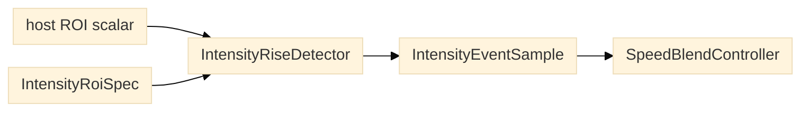

# ROI-associated intensity traces

`IntensityRoiSpec` binds each `IntensityEventTrace` to a rectangle in the
delivered frame and a host-defined scalar meaning. Coordinates use
`(y, x, height, width)` relative to the delivered `sensor_shape_yx`; the active
camera ROI origin and binning remain in the calibration. `roi_mode` records
whether the signal uses the camera readout ROI or a software slice. The same
causal detector works for an edge band, an interior slit, or the whole frame:

```python
from planner import IntensityRoiSpec, detect_intensity_rise

roi = IntensityRoiSpec(
    trace_id="edge-x-positive-run-01",
    sensor_shape_yx=(1024, 1024),
    roi_yxhw=(0, 960, 1024, 64),
    signal_metric="integrated_positive_excess",
    roi_mode="software_slice",
)
trace = detect_intensity_rise(signal_samples, roi=roi)
```



*Figure 1. The host turns frames into one scalar per ROI; the planner consumes
the scalar, never the image.*

For per-frame host decisions, use `IntensityRiseDetector` and call `update`
once per delivered ROI signal. It retains only baseline/event state and returns
an `IntensityEventSample` immediately. A new detector instance starts a new
trace segment when ROI geometry, signal meaning or acquisition epoch changes.
`detect_intensity_rise` uses the same incremental implementation to build a
complete trace, so batch replay and per-frame updates share the same causal
state transitions.

`signal_metric` names the scalar's meaning, not its compute backend. The planner
never receives image arrays or imports a GPU library: an acquisition host may
compute an ROI median on its bounded GPU path, then pass the resulting scalar
to this detector and record the metric/backend provenance in the host trace.

To turn each event sample into a fast-search/slow-imaging proposal as frames
arrive, use `SpeedBlendController`. Convert nonnegative relative rise to a
normalized interest using a declared saturation value, then call `update` once
per frame. It returns the current smoothed interest, desired speed and
acceleration-limited proposal without retaining the full trace:

```python
from planner import SpeedBlendConfig, SpeedBlendController

speed = SpeedBlendController(
    slow_speed_um_s=50,
    fast_speed_um_s=500,
    sample_interval_s=0.02,
    config=SpeedBlendConfig(max_acceleration_um_s2=2500),
    initial_speed_um_s=500,
)
interest = min(1.0, max(0.0, (event.relative_rise or 0.0) / 0.3))
proposal = speed.update(interest)
```

`RoiIntensitySpeedPolicy` now packages the incremental rise detector and this
intensity-to-speed mapping for streaming use. Call `update_intensity` and then
`propose_speed` with the returned event sample. The host still computes the ROI
scalar (including any GPU median) and records timing; the planner owns only the
causal policy and never inspects frames or commands a device. Its model
parameters remain assumptions until calibrated against labeled events and
measured stage behavior.

The model is causal and stateful; its smoothing window and previous proposal
are bounded. `blend_intensity_to_speed` uses the same controller, keeping batch
replay and streaming calculations aligned. The proposal is a pure calculation:
the host decides whether a device supports runtime speed updates, and must
enforce measured motion, braking and resource limits before any command.

For a middle slit, change `roi_yxhw` (for example, `(0, 480, 1024, 64)`). For a
whole-frame trace, use `(0, 0, 1024, 1024)`. Select the edge rectangle using the
calibrated image-to-stage axis mapping and the current travel direction; this
module does not assume which sensor edge is leading.

`signal_metric` identifies how the host made each scalar sample. It can be
integrated positive excess, a normalized sum, or another consistently defined
signal. The rise detector consumes those scalar samples and does not depend on
the image-integration method. Keep one fixed ROI geometry and signal meaning per
trace ID; use a new ID when either changes. The detector output carries the ROI
descriptor alongside baseline, rise, active-state and onset/release arrays.

ROI bounds are validated against the delivered `sensor_shape_yx`. For a trace
using all pixels in a camera hardware ROI, set `roi_mode="camera_readout"` and
use the complete delivered frame rectangle. This descriptor records the readout
mode but does not claim that hardware ROI improved frame rate; measure that on
the camera. This is a recipe/data contract only: the planner does not crop
images, change hardware ROI, or command the stage. For stage-aware event
association and braking feasibility, use the separate `RoiIntensityEvent` and
`assess_roi_event_transition` records.

For controllers that report X and Y independently, use
`StageAxisPositionObservation` and `estimate_stage_motion_from_axes`. Supply the
exact request ID, independent per-axis sample sequences and brackets, a declared
position uncertainty, and an explicit monotonic freshness-evaluation time. The
estimator fits each axis separately at the latest timestamp seen on either axis
and evaluates freshness at the supplied time; it never pairs asynchronous reads
into a simultaneous XY pose. The caller must keep the
controller clock domain and calibration provenance with its source records.
Fits with stale or sparse samples, broad timing brackets, reversals, unresolved
motion, or excessive residuals are marked unusable.

Each fitted axis also carries position at `window_end_ns` and its fit-derived
standard error. When an ROI event is associated, the record propagates that
position to the mapped event time and carries a conservative per-axis bound
that adds fit-position uncertainty, velocity/acceleration uncertainty,
read-call bracket width and ROI-to-host clock-mapping uncertainty. This bound
does not include physical scale/absolute-position calibration error or establish
the exposure-time pose; those require separate calibration and clock evidence.
