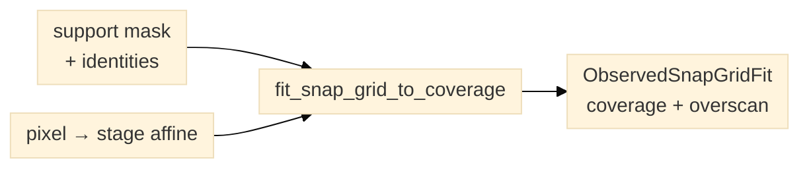

# Observed-coverage snap-grid geometry

`planner.observed_coverage` accepts a registered support-mask array with
source-run, registration, coordinate-frame and calibration identities. Its
`fit_snap_grid_to_coverage` function places camera footprints in the mask pixel
frame, maps tile centers and footprint corners to stage readback coordinates
through the supplied affine, and reports support coverage, missed support,
overscan and stage-envelope violations. Mask holes remain unsupported target
pixels; the returned record references the durable mask instead of embedding
its bytes.



*Figure 1. A support mask and a pixel-to-stage affine produce a fitted snap
grid, not a confirmed boundary.*

Keep `mask_reference` valid for the saved fit record: use a path relative to
the fit's directory, or include a `source_coverage_record` path in the fit. The
IX83 host then resolves `mask_reference` relative to that source record. The
host also retains the registration-record lookup for older fit layouts. When
moving a fit record to another directory, update its relative provenance paths
and verify the shape and SHA-256 again. The IX83 host preview checks both before
displaying the plan.

The affine is a planning transform, not proof of calibrated physical scale.
The function creates no RunEngine, hardware binding, stage command, or sample
boundary assertion. Callers must supply and check the expected run,
registration, pixel/stage coordinate frames and calibration IDs. A fit with
any out-of-envelope tile is flagged and must not be executed.

```python
from planner.observed_coverage import ObservedCoverage, fit_snap_grid_to_coverage

coverage = ObservedCoverage(
    coverage_id="run-42-registration-3",
    source_run_id="run-42",
    registration_id="registration-3",
    coordinate_frame="mosaic-pixels",
    stage_coordinate_frame="stage-readback-um",
    calibration_id="camera-stage-calibration-7",
    mask_reference="coverage-mask.tif",
    support_mask_sha256=normalized_mask_sha256,
    support_mask=support_mask_array,
    pixel_to_stage_affine_xy_um=((a00, a01, tx), (a10, a11, ty)),
    uncertainty_px=2.0,
)
fit = fit_snap_grid_to_coverage(
    coverage,
    footprint_xy_px=(768, 768),
    overlap=0.5,
    fov_calibration_id="camera-stage-calibration-7",
    expected_source_run_id="run-42",
    expected_registration_id="registration-3",
    expected_coordinate_frame="mosaic-pixels",
    expected_stage_coordinate_frame="stage-readback-um",
    stage_envelope_xy_um=(xmin, xmax, ymin, ymax),
)
```

The result is an `ObservedSnapGridFit`, not a `SnapScanPlan`: the latter retains
its operator-confirmed `ConfirmedBoundary` contract and whole-footprint-inside
claim. Both fit types can now be passed to `planner.plans.snap_scan_plan`; the
observed-coverage branch embeds `fit.to_record()` in run metadata and uses the
coverage-derived stage positions. Host-side device binding and message-adapter
support remain separate work. The IX83 Redsun Presenter provides a read-only
`preview_observed_coverage_snap_grid` review plan that validates the referenced
support-mask TIFF against its shape and SHA-256, then shows the support,
proposed tile footprints, missed support and overscan in registered-mosaic
pixel coordinates. The preview does not authorize execution. The host must
preflight the current device state and limits before a separate acquisition
plan runs.
