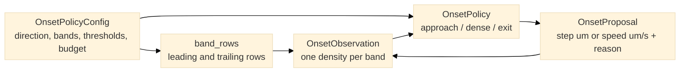

# Onset policy for stepped search-to-detail moves

`planner.onset_policy` turns one measured density per declared sensor band into
the next along-track request for a single traverse. It is the pure form of the
policy the 2026-10-26 sessions ran from a runner: a target's arrival starts a
dense stretch, the target reaching the far edge ends it, and a distance budget
bounds the stretch when the signal alone would not.

It sits beside, not inside, the two existing intensity mechanisms:
[the adaptive broom plan](adaptive_broom.md) turns a whole-frame intensity into
a continuous *speed* request, and [ROI-associated intensity
traces](intensity_roi_trace.md) detect a rise on one declared region. This
policy makes the *stepped* decision - a coarse increment, a dense increment, or a
hold - and names the reason for it.

*Figure 1. The host slices the rows the config names, supplies one density per
band per frame, and executes the returned request. The policy holds no device.*

## Bands and travel direction

Content moves toward increasing image rows for increasing stage x, measured at
`5.341 +- 0.295` px per stage um on the 2026-10-26 strip. The band a target
reaches first is therefore the low-row edge for `increasing_x` and the high-row
edge for `decreasing_x`:

| Direction | Leading band | Trailing band |
| --- | --- | --- |
| `increasing_x` | rows `0 .. depth` | rows `height - depth .. height` |
| `decreasing_x` | rows `height - depth .. height` | rows `0 .. depth` |

`depth` is `round(height * band_fraction)`, at least two rows. `band_fraction`
is capped at `0.5`. The recorded pass that produced the closed-loop evidence ran
with **decreasing** x and fired on the high-row band first, which is the leading
edge only under that layout.

## State machine

One instance covers one traverse and one camera/band epoch. Both detectors are
updated on every measured frame, so each band clears itself after a target
passes and can report the next one.

| State | On this frame | Next request |
| --- | --- | --- |
| `approach` | no leading-band rise | `advance_coarse` |
| `approach` | leading-band rise confirmed | `advance_dense`, state `dense` |
| `dense` | trailing-band rise confirmed | `advance_coarse`, back to `approach` (`released_by_trailing_band`) |
| `dense` | whole-frame rise fell below the exit threshold | `advance_coarse`, back to `approach` (`released_by_signal_fall`) |
| `dense` | budget cannot afford another dense step | `advance_coarse`, state `exit` (`dense_budget_exhausted`) |
| `exit` | any | `advance_coarse` (`after_dense_budget_exhausted`) |
| any | a required density is `None` | zero-motion hold, state unchanged |

The two trigger modes pair with exactly one release each, and the config rejects
the other combinations: a leading-edge band cannot report that a target crossed
the field, and a whole-frame rise cannot report a target leaving one edge.

## Dense budget

`dense_budget_um` is cumulative for the traverse and is counted when a dense
request is issued. Once it is spent, the policy stays in `exit` and stops
requesting dense frames for the rest of the traverse. That matters because a
whole-frame signal stays elevated across a bright region: the 2026-10-26
whole-strip run was active for 122 of 176 frames, and the bounded run that
capped the brake reached 120.9 um and finished a strip in 127 frames at 0.75
s/frame instead of 176 frames at 1.12 s/frame. A budget of zero exhausts on the
onset frame without a dense step.

## Request forms

`mode="stepped"` returns `step_um` for one point increment and leaves
`speed_um_s` empty. `mode="continuous"` returns `speed_um_s =
step_um / frame_period_s` and leaves `step_um` empty. The two never share a
field, so a host cannot mistake a step for a velocity. A continuous request is
arithmetic, not evidence that a stage can change speed during a move; that
capability belongs to the host's qualified binding.

## Missing observations

A frame whose required density is `None` never advances the traverse. The first
`max_missing_observations` consecutive misses return a zero step with
`hold_missing_observations`; later ones return `blocked_missing_observations`.
The state and the budget are unchanged, and the host decides whether to stop the
run. A missing trailing band is equally a hold while the policy is dense.

## Host contract

1. Declare `sensor_height_px`, `band_fraction`, `direction` and the thresholds
   in `OnsetPolicyConfig`, and record `config.as_dict()` with the run.
2. Slice `config.band_rows` and compute one nonnegative scalar per band per
   delivered frame.
3. Call `OnsetPolicy.update(OnsetObservation(index, leading, trailing))` in
   strictly increasing frame order and execute the returned request.
4. Write `proposal.to_dict()` per frame; it carries `policy_id`, which is the
   SHA-256 of the serialized config, so a decision can be traced to the exact
   thresholds that produced it.

The policy emits no Bluesky message and imports no acquisition host; the package
boundary test covers the module.

## Limits

- The density is host-defined. The policy does not filter, background-correct or
  validate an image statistic.
- The request is not the outcome. Step size, arrival, settling and the executed
  distance are the host's readbacks, and the dense budget counts requested
  distance.
- The thresholds are specimen-specific. The 1.20 ratio the sessions measured is
  a rosette-sample result; a live cell needs its own baseline and band sizes.
- The policy does not model acceleration, backlash or a stage's dead band, and
  it is not a real-time controller.
