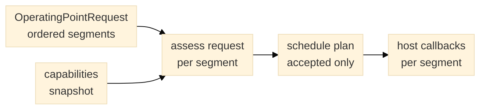

# Operating-point schedules

`OperatingPointRequest` is the planner's typed input for lowering an
optimization decision into an ordered Bluesky run. Each `OperatingPointSegment`
records its corner, mode epoch, signed XY direction, path endpoints, velocity,
length, acceleration allowance, exposure, frame period, detection width, sensor
ROI/binning, optional virtual slit, metrics snapshot, thresholds, utility,
measurement verdict and calibration/pose identifiers. The request also records
recipe, coordinate-frame, timestamp and planner software-version provenance.

*Figure 1. Only an accepted request reaches the schedule plan, which invokes the
host callbacks in segment order inside one run.*

The `path_start_xy_um` and `path_end_xy_um` are the complete commanded segment
endpoints, including any acceleration or deceleration overrun that must remain
inside the travel envelope. `OperatingPointCapabilities` declares the sensor
shape, camera exposure/frame/trigger limits, stage speed/acceleration limits and
rectangular XY bounds from the execution host's current qualified profile. The
planner compares every segment with these declarations and preserves rejection
reasons by segment. It does not estimate missing limits or convert raw encoder
counts to micrometres.

Camera ROI coordinates are sensor `xywh`; binning uses `yx`. ROI origin and
dimensions must align to the declared binning. A change to ROI,
binning, exposure or trigger mode requires a new `epoch_id`. Reusing a closed
epoch identifier is rejected. A virtual slit is a processing region in delivered
frame pixels and does not change the camera epoch.

`assess_operating_point_request(request, capabilities)` is the pure feasibility
gate. `operating_point_schedule_plan(...)` accepts only a fully accepted request
and requires two host callbacks that yield Bluesky messages:

- `configure_segment(segment)` applies the segment's configuration at the
  segment boundary, including speed before motion.
- `acquire_segment(segment)` runs the host's capture/motion sequence for that
  segment.

The planner opens one run, invokes both callbacks in request order, and stores
the complete request, capability snapshot, and feasibility decision in run
metadata. It creates no devices or RunEngine, and never changes speed during an
active move. A requested acceleration is checked against the host-declared
capability; it is not a claim that a specific adapter can realize a continuous
speed curve. The host must supply a callback backed by a qualified device
capability or reject the request.

## Point-local window for overlap-mode comparison

For an interior point in a straight, constant-speed pass, the model estimates
the time that point remains inside the moving detection footprint as
`detection_width_um / velocity_um_s`. It estimates the number of successive
frames containing that point as
`detection_width_um / (velocity_um_s * frame_period_s)`. The schedule serializes
these as `expected_t_obs_s` and `expected_n_obs`. They define a modeled
point-local timelapse window and expected sample count for overlap-mode
comparison; they are not cumulative exposure time or proof that each frame
contains usable signal.

The estimates assume uniform motion and an interior location. Frame phase,
finite strip ends, acceleration, deceleration, dropped frames, invalid image
support and registration rejection change the observed window and integer frame
count. A matched report should derive those actual values from accepted frame
positions/timing and the common valid-support mask, while retaining these
schedule values as the theoretical reference. For snap-scan, calculate the
point's exposure/revisit window from the accepted tile positions and timestamps
instead of using the moving-footprint formula.

`OperatingPointRequest.from_dict()`, `OperatingPointCapabilities.from_dict()`
and `OperatingPointDecision.from_dict()` accept only their versioned schemas,
reject missing or unknown fields, and revalidate all invariants. Serialized
segment records also carry derived observation count, residence time and blur;
the parser checks these against the source parameters instead of trusting
copied summaries. `thresholds_used` snapshots must be JSON-shaped values with
string object keys and arrays represented as lists; Python-only keys and
containers are rejected rather than coerced during serialization.
