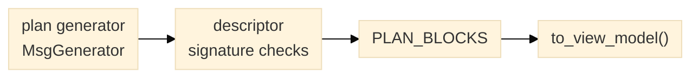

# Planner plan-block descriptors

`planner.plan_blocks.PLAN_BLOCKS` pairs each public Bluesky plan generator in
`planner.plans`, `planner.search_imaging` and `planner.operating_schedule` with
its host-facing contract. Resolve a stable block ID with `get_plan_block()`:

```python
from planner import get_plan_block

block = get_plan_block("planner.live_median_scan")
print(block.plan_stub.__name__)
for parameter in block.parameters:
    print(parameter.name, parameter.type_name, parameter.units)
view_model = block.to_view_model()
```



*Figure 1. A descriptor is built from the callable and checked against it; the
view model omits the callable.*

Each descriptor records its contract version, plan callable, argument names and
types, units/defaults, structural device contracts, typed resource requirements
and sharing modes, physical effects, preconditions, completion/failure conditions,
and validation-evidence references. Empty `validation_evidence` means this catalog
entry has no attached acceptance evidence yet.

The descriptors can support host-side plan discovery and view generation. They
do not bind devices, validate a device's advertised capability, check calibrated
travel limits, acquire resource locks, decide whether a plan is safe for a
particular instrument, or prove that a physical effect completed. The Redsun
Presenter or another host owns those checks and any confirmation UI. Descriptors
are runtime Python objects, not a persisted schema or run record.

At catalog construction, each descriptor checks its parameter order and names,
required flags, and default values against the callable signature. A plan stub
must be an actual generator function, with its Bluesky message-generator return
type visible to runtime introspection. A plan stub with variadic arguments must
receive an explicit contract before it can be added to this catalog. The catalog
also rejects duplicate block IDs and duplicate plan-callable registrations.

`to_view_model()` returns a fresh host-facing dictionary without the callable.
Use it to populate a view or help panel; it is intentionally not a versioned
serialization format, run record, or execution request.

A host may surface descriptor metadata alongside its plan actions. Each host still
owns device binding, capability checks, travel limits, resource policy,
confirmation and physical acceptance. Catalog metadata describes the plan
contract; it does not establish instrument readiness.
The catalog does not cover pure recipe builders or geometry helpers: these do
not emit Bluesky messages. Do not infer a plan block from a function signature
alone; every new plan generator must document its physical effects, preconditions
and interruption behavior as well as its arguments.
