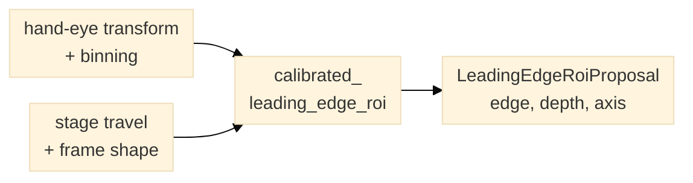

# Calibrated leading-edge ROI proposal

`planner.calibrated_leading_edge_roi` computes a reviewable, axis-aligned
detector ROI proposal from a hand-eye linear transform, binning, planned XY
stage travel, delivered frame shape and band depth. It predicts stationary
specimen image motion opposite to stage travel and selects the corresponding
dominant readout edge.

For a rotated camera, the helper reports the fraction of motion along the
selected axis; it does not represent a true oblique edge. The result is readout
relative, so a crop can make the reported edge differ from the physical sensor
edge.



*Figure 1. The helper predicts the readout edge from calibrated motion; the host
still validates the camera mode and labels the proposal.* The helper does not validate calibration provenance, configure a camera,
or qualify a biological detection ROI. A host must check the calibration against
the current camera mode and keep the proposal reviewable until validated against
labeled image-entry events.

```python
from planner import calibrated_leading_edge_roi

proposal = calibrated_leading_edge_roi(
    calibration_id="example-hand-eye-calibration",
    pixel_to_stage_um_per_native_px=((0.1, 0.0), (0.0, -0.1)),
    binning_xy=(2, 2),
    stage_travel_xy_um=(100.0, 0.0),
    frame_shape_yx=(1024, 1024),
    depth_px=64,
)
```
