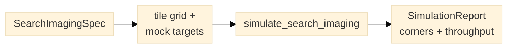

# Search-and-image simulation

`planner.simulation` estimates a two-round search-and-image run without a
device: round one covers a declared specimen field with overlapping snap tiles,
round two revisits declared mock target positions for focused acquisition. It
reads no pixels and makes no claim about detector recall; the targets are mock
positions, not detections. The report is a planning estimate, not a timing
measurement.



*Figure 1. The simulator turns a declared specification and mock targets into a
report, not a measurement.*

## Inputs

`SearchImagingSpec` combines a rectangular field, two round specifications, a
stage profile and the mock targets:

| Record | Fields |
|---|---|
| `SearchImagingSpec` | field `(width, height)` um, survey, focused, stage, targets, origin, review time |
| `SurveySpec` | tile `(width, height)` um, overlap, exposure, frames, readout, per-tile overhead, pixel size, resolution |
| `FocusedSpec` | exposure, frames, channels, z planes, readout, per-target overhead, pixel size, resolution, ROI `(width, height)` um |
| `StageProfile` | maximum velocity um/s, acceleration um/s^2, settle time |
| `MockTarget` | target id and center xy um |

`mock_targets(field, count, seed=..., margin_um=...)` places deterministic
uniform mock targets. The survey and focused rounds carry independent pixel
size and resolution fields, so the survey can run at the same magnification as
the focused round; a lower-magnification overview is one supported choice, not
an assumption of the model.

## Round one: overlapping survey

Tile centers start at half a tile from the field origin and advance by
`tile * (1 - overlap)` on each axis; a tile larger than the field is one centered
tile. Rows are traversed in serpentine order, reversing x on odd rows. The last
tile may extend past the field edge; `overscan_um` reports by how much.

`SearchImagingSpec.survey_tiles()` returns `SurveyTile` records in acquisition
order, and `survey_centers()` returns just their centers.

## Time estimate

Each move uses a symmetric trapezoidal profile: a move long enough to reach the
maximum velocity cruises at that velocity, a shorter move is triangular. The
settle time is added once per nonzero move. Per position the estimate adds:

```text
survey   exposure * frames + readout * frames + overhead, plus move and settle
focused  (exposure + readout) * frames * channels * z_planes + overhead,
         plus move and settle
```

The focused round visits targets greedily by nearest neighbour from the last
survey position. Round totals are `RoundReport` records with separate travel,
settle, exposure, readout and overhead components and their sum.

## Throughput and the equivalent operating point

```text
survey throughput        field area / survey round time
end-to-end throughput    field area / (survey + review + focused)
targets per hour         targets * 3600 / total time
```

Round one is reported twice:

- `survey_acquisition` is the configured snap tile: velocity zero, the declared
  exposure and tile width.
- `survey_equivalent` is the continuous operating point whose ideal area
  throughput `v * H` equals the simulated survey throughput, so
  `v_equivalent = survey throughput / tile height`. Its motion-blur terms are a
  modelling convenience, not a prediction of a snap exposure; only the
  acquisition points receive feasibility verdicts.

An envelope classifies both points and the focused point into corners. A
step-and-snap survey typically lands on `001` as a configured point and `101`
as the equivalent continuous point; a focused revisit on `010` or `011`
depending on exposure and ROI width.

```python
from planner import (
    FocusedSpec,
    SearchImagingSpec,
    StageProfile,
    SurveySpec,
    mock_targets,
    simulate_search_imaging,
)

spec = SearchImagingSpec(
    field_size_um=(4000.0, 3000.0),
    survey=SurveySpec((900.0, 700.0), 0.1, 0.01, 1, 0.005, 0.05, 0.65, 1.0),
    focused=FocusedSpec(0.2, 1, 2, 1, 0.02, 0.2, 0.108, 0.25, (64.0, 64.0)),
    stage=StageProfile(5000.0, 20000.0, 0.05),
    targets=mock_targets((4000.0, 3000.0), 50, seed=7),
    review_s=30.0,
)
report = simulate_search_imaging(spec)
print(report.survey.total_s, report.survey_throughput_um2_s, report.targets_per_hour)
```

`SimulationReport.to_dict()` is JSON-safe and carries the round breakdown, the
throughput figures, both survey points, the focused point, and any corner or
feasibility results requested through `envelope=` or `limits=`.

## Sub-scan and averaged metrics

The dual-scan report keeps each round's own metrics beside the overall view.

`ScanMetrics` describes one sub-scan:

| Field | Survey meaning | Focused meaning |
| --- | --- | --- |
| `scan_id` | `survey` | `focused` |
| `positions` | tiles | targets |
| `area_um2` | field area | targets x focused ROI area |
| `throughput_um2_s` | area / survey duration | area / focused duration |
| `seconds_per_position` | duration / tiles | duration / targets |
| `travel_fraction`, `exposure_fraction` | share of the sub-scan duration | share of the sub-scan duration |

`AveragedMetrics` adds the cross-round view:

| Field | Definition |
| --- | --- |
| `mean_throughput_um2_s` | arithmetic mean over nonempty sub-scans |
| `mean_seconds_per_position` | arithmetic mean over nonempty sub-scans |
| `mean_travel_fraction`, `mean_exposure_fraction` | arithmetic means over nonempty sub-scans |
| `combined_acquired_area_um2` | survey field area + focused target ROI area |
| `combined_throughput_um2_s` | combined area / (survey + focused duration, no review) |
| `total_duration_s` | survey + review + focused |

An empty focused round is excluded from the means rather than dragging them
toward zero. `combined_acquired_area_um2` counts image area acquired in both
rounds, so it double-counts the field area already covered by the survey; it is
not unique specimen area. The existing `end_to_end_throughput_um2_s` is the
unique-area figure including review time.

`python -m planner simulate` prints a `sub-scan metrics` block and an
`averaged metrics` block, and the `--json` report carries the same values as
`sub_scans` and `averaged`.

## Photobleaching before the focused scan

The dual snap scan exposes every sample during the overview before the 2 s
focused revisit. `SimulationReport.photobleaching` records that pre-exposure:

| Field | Meaning |
| --- | --- |
| `preview_exposure_s` | exposure of one overview tile |
| `mean_cover_count` | average number of overview tiles covering a sample |
| `prior_exposure_s_min/mean/max` | total overview exposure on a sample |
| `focused_exposure_s` | focused exposure per sample |
| `cost_min/mean/max` | `prior_exposure / focused_exposure`, relative to 1 |
| `retained_*` | `exp(-prior_exposure / tau)` when `bleach_time_constant_s` is declared |
| `loss_fraction_*` | `1 - retained_*` |

`cost` is relative to one focused exposure: 0 means no preview light, 1 means
the preview delivered as much light as the focused scan. A 20 ms tile on a 2 s
focused exposure contributes 0.01, and a sample covered by two overlapping
tiles contributes 0.02.

The log-linear brightness fraction is `retained = exp(-prior / tau)`, where
`tau` is the declared `bleach_time_constant_s` on `SearchImagingSpec` (or the
CLI's `bleach_time_constant_s` key). Without a declared constant only the
exposure and cost are reported; no decay is invented.

The preview **increases** the exposure cost and **decreases** the retained
brightness. They are not exact inverses: `cost` normalizes exposure time while
`retained` is a brightness fraction. Report both when the meaning matters:
`cost` answers "how much extra light did the survey deliver", `retained`
answers "what fraction of the initial ADU remains for the focused scan". The
integrated focused brightness is proportional to `retained`, because bleaching
during the 2 s exposure itself cancels in the ratio to an unbleached scan.

## HTML throughput report

`planner simulate spec.json --html throughput.html` writes a self-contained
graphical page: summary cards, a wall-time bar chart, stacked survey/focused
time breakdowns, a throughput chart, the sub-scan table, the photobleaching
table and the operating-point corners. It uses inline CSS and SVG only, with no
JavaScript and no network request, so the file can be opened offline.

`planner compare --html comparison.html` writes a single page for all
adaptive-broom versus dual-snap scenarios: two separate geometry layouts in
the same page (snap overview tiles plus focused boxes, and broom strips plus
two-second slow zones), grouped wall-time bars per scenario and sample count,
the full comparison table and the bleach-cost column.

## Operating-space trajectories

The HTML pages include a three-projection operating-space map beside the corner
table: `v`-`T_e`, `v`-`W` and `T_e`-`W`. The dual snap scan contributes its
survey tile, survey equivalent and focused revisit points; the adaptive broom
contributes a dwell-ramp-cruise-ramp-dwell sequence along one row. Arrows follow
acquisition order, and each point carries its corner label when the
specification declares an acquisition envelope.

The shaded low/high bands come from the declared `envelope` thresholds. Without
an envelope the map still shows the trajectory and the operating range, but it
does not invent regime boundaries.

## Limits of the estimate

- Target count and positions are declared; there is no detection probability,
  false-negative rate or review editing model.
- Autofocus and z travel are not modelled beyond the declared per-position
  overhead; multi-axis acceleration coupling and stage following error are
  ignored.
- Camera trigger latency is not modelled beyond the declared readout and
  per-position overhead.
- The focused ROI is one declared size applied to every target; a per-target ROI
  carried by a workflow record is plan metadata and does not change the
  estimate.
- The nearest-neighbour target order is an estimate, not an optimal tour.
- No stage envelope is asserted; a real host must preflight field, overscan and
  target positions against its own limits before execution.
