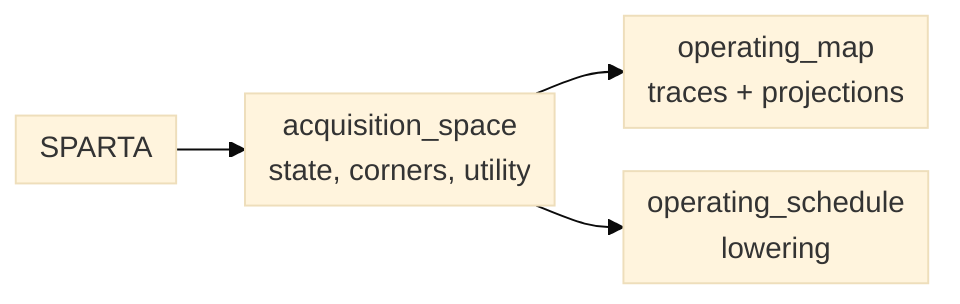

# SPARTA framework

**SPARTA** — Spatiotemporal Pareto Acquisition-Regime Trajectory Allocation — is
the conceptual name for the optimization framework over the acquisition space.
The acquisition space defines the state `u = (v, T_e, W)` and its eight limiting
regimes; SPARTA selects and moves between those regimes according to an
application utility and a feasibility envelope.

SPARTA is a name for the idea, not a vocabulary users must learn before calling
the planner. Start with the ordinary types and functions; the framework name
belongs in the paper, the top-level README and this page. The
[architecture page](architecture.md) diagrams the model and its place between a
host and Bluesky.

## What lives where

| Layer | Module or type |
| --- | --- |
| Acquisition state and metrics | `planner.acquisition_space` |
| Framework name anchor | `planner.sparta` (`FRAMEWORK_NAME`, `FRAMEWORK_TITLE`) |
| Broom trajectory timing | `planner.broom` |
| Two-round simulation | `planner.simulation` |
| Operating-space traces | `planner.operating_map` |
| Operating-point schedule and plan lowering | `planner.operating_schedule` |
| HTML reports | `planner.report_html` |



*Figure 1. The framework name maps to plain modules; no ordinary type carries a
`Sparta` prefix.*

The day-to-day API keeps plain names:

```python
from planner.acquisition_space import AcquisitionEnvelope, AcquisitionPoint
from planner.operating_map import OperatingTrace, broom_trace
from planner.simulation import simulate_search_imaging
```

`AcquisitionPoint` is the control vector `(v, T_e, W)` plus the pixel and frame
context. `AcquisitionEnvelope` supplies the low/high thresholds that define the
eight corners and the shaded bands in the HTML operating map. `OperatingTrace`
is an ordered path through the space, such as the adaptive broom's
dwell-ramp-cruise-ramp-dwell sequence. None of these needs a `Sparta` prefix.

An evaluated schedule is represented by `OperatingPointRequest` and ordered
`OperatingPointSegment` records. `assess_operating_point_request` combines each
segment's measurement verdict with a host-supplied capability snapshot for
sensor ROI/binning, exposure, frame cadence, stage speed, acceleration and
travel bounds. `operating_point_schedule_plan` rejects any infeasible segment
before opening the run, then records the exact request and decision in run
metadata while invoking host configuration and acquisition plan callbacks in
segment order.

## Operating map

The HTML reports project operating traces into `v`–`T_e`, `v`–`W` and `T_e`–`W`.
Arrows follow acquisition order; corners appear where the declared envelope
classifies every axis; points outside a band are intentionally unlabelled rather
than silently snapped to a corner.

## Naming rule

Use **SPARTA** only where it claims the framework's conceptual contribution:
paper and report titles, the top-level README introduction, this page, and the
changelog. Do not prefix ordinary types (`SpartaPoint`, `SpartaEnvelope`, …), add
a `planner sparta` command, or repeat the acronym in every visual heading. That
keeps the name distinctive without making a new user read the model first.
